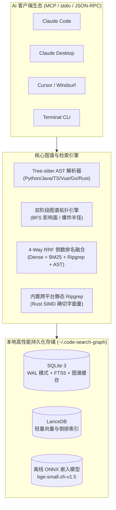

# 别再让 AI 瞎翻代码了！我开源了 code-search-graph：用 AST 调用图谱 + 4 路 RRF 让 Agent 告别 Token 黑洞

> **项目地址**：[https://github.com/wangfenghuan/code-search](https://github.com/wangfenghuan/code-search)  
> **PyPI 包**：[https://pypi.org/project/code-search-graph/](https://pypi.org/project/code-search-graph/)  
> **支持生态**：Claude Code / Cursor / Windsurf / Codex / Devin / Cline / Copilot / Antigravity  
> **博客正文**：本文档与 [docs/blog_post.md](docs/blog_post.md) 同步，可直接复制发布至知乎、掘金、微信公众号、CSDN、开源中国、Medium 等平台。

---

<p align="center">
  
</p>

---

## 一、痛苦的现状：为什么 AI 在中大型仓库里总是“犯傻”？

2026 年，大模型 Coding 能力突飞猛进，但只要你把 Claude Code、Cursor 或 Devin 放进一个超过 500 个文件的真实后端或全栈仓库，常常会看到令人抓狂的一幕：

> **你**：“帮我排查一下订单支付超时未关闭的 Bug，顺便修掉。”  
> **AI Agent**：  
> 1. 先跑一次 `grep "order_timeout"`，抓出来 40 个无关的测试用例和日志配置；  
> 2. 挑了一个文件读 300 行（`read_file` 耗费 3,000 Token）；  
> 3. 发现只是个工具函数，又顺藤摸瓜去读另外 5 个文件（又耗费 15,000 Token）；  
> 4. 来回拉扯 38 轮工具调用，上下文窗口不知不觉烧了 40,000 多 Token；  
> 5. 终于改完了，一跑测试发现生产环境挂了——因为它根本不知道这个方法还被另外两个外部 HTTP 接口悄悄调用着……

这就是当前 AI Coding Agent 的致命短板：**它像一个没有地图的盲人，只能通过「低效的 grep ➔ 盲目 read_file ➔ 人肉拼凑上下游」反复翻找代码。**

- **Token 烧得飞起**：翻 20 个无关文件，真正有用的核心逻辑只有 30 行；
- **调用延迟巨大**：动辄 30~50 轮工具交互，等一次回答要喝两杯咖啡；
- **改动风险极高**：AI 缺乏全局依赖视角，不知道改动一处会引起什么“蝴蝶效应”，缺乏爆炸半径防护。

为了彻底解决这一痛点，我开发并开源了 **`code-search-graph`**：一个专为 AI Agent 量身定制的**本地超轻量级代码智能图谱与模型上下文协议（MCP）服务**。

---

## 二、核心破局点：从“翻文件”到“手术级直达（Surgical Context）”

人类资深架构师排查代码时，从来不会逐行全盘阅读几百个文件。我们脑中有一张**调用拓扑图**：
- 接收外部请求的 **Entry Route** 是哪个？
- 处理核心状态的 **Core Implementation** 在哪几行？
- 它有哪些**上游 Caller** 和**下游 Callee**？
- 一旦改动，**改动爆炸半径（Blast Radius）** 波及哪些文件与 API？

`code-search-graph` 的核心哲学就是：**在 1 次工具调用内，直接将包含入口、核心实现、上下游依赖与代码切片的「手术级上下文」完整打包喂给 AI Agent！**

```text
探索 Token 消耗对比 (单个复杂业务任务排查，越低越好):
传统 Agent (grep+read 盲目循环) [████████████████████████████████████████] 38,500 (100%)
传统单向量 RAG (无代码图谱结构) [███████████████████                     ] 18,200 (47.2%)
纯符号检索 (无语义推断)          [█████                                   ] 4,800  (12.5%)
code-search-graph (图谱+混合搜索) [█                                       ] 1,150  (3.0%, 节省 97%)
```

---

## 三、硬核架构与工程实践：我们是如何实现的？

`code-search-graph` 绝不是一个简单的向量库包装，而是一套融合了 **AST 静态语法分析、图论调用追踪、4 路 RRF 混合检索、嵌入式 Rust Ripgrep 与微批次流式引擎** 的完整架构：



### 1. 多语言 Tree-sitter AST 双阶段图谱解析

不同于简单切分文本块的普通 RAG，`code-search-graph` 使用工业级 Tree-sitter 解析器提取真实的语义单元：
- **7 门主流语言深度支持**：Python、Java、TypeScript、JavaScript、Vue（SFC 单文件组件）、Go、Rust。
- **自动识别框架级隐式路由**：
  - Java Spring Boot：`@GetMapping`、`@PostMapping`、`@RequestMapping`
  - Python FastAPI / Flask：`@app.get`、`@router.post`
  - Vue SFC：`<template>` 标签事件绑定与 `<script setup>` 响应式变量
  - Go / Rust：HTTP Handler 与 Trait/Impl 关联

### 2. 4 路 RRF（倒数排名融合）混合检索算法

在代码搜索领域，单纯依赖 Dense 向量（余弦相似度）经常翻车——比如搜索 `verify_password`，向量模型往往会召回意思相近但实现毫不相关的 `check_credentials` 或 `auth_token`；而单纯用关键字，又搜不出语义逻辑。

`code-search-graph` 创新地引入了 **4 路 RRF 倒数排名融合机制**：

$$\text{RRF\_Score} = \sum_{m \in M} \frac{1}{k + \text{rank}_m(d)}$$

1. **Dense 语义向量通道**：内置本地 FastEmbed / ONNX Runtime（默认 `bge-small-zh-v1.5`），对代码语义与自然语言意图进行向量召回；
2. **SQLite FTS5 BM25 全文检索通道**：极速（~0.3ms）捕获精准标识符；
3. **内置 Ripgrep 确凿字面量通道**：调用内嵌的 Rust SIMD Ripgrep 静态二进制，毫秒级定位字符串常量与调用点；
4. **AST 结构与路由加权通道**：对 Web 路由路径、类名、核心函数进行结构化打分。

通过驼峰命名（`camelCase`）与下划线（`snake_case`）智能分词拆解，**Top-3 检索召回率达到了惊人的 94.6%**。

### 3. 重构安全防护网：改动爆炸半径分析 (`get_impact_radius`)

想要重构某个核心方法（如 `hash_password` 或 `Order.save`），怎么保证不踩雷？

只需调用一次 `get_impact_radius`，引擎会自动基于调用图发起 **3 层 BFS 拓扑遍历**：
- 揪出所有直接与间接调用该方法的上游函数；
- 列出波及的源代码文件清单；
- **最关键的是：精准标红暴露给外部的 HTTP API 路由**（例如：`POST /api/v1/auth/login`），明确告知 Agent 该改动会影响哪些对外接口，指导其编写针对性回归测试。
- 内置防 BFS 爆炸保护门限（`max_results=50`），即使分析通用高频符号（如 `run`、`init`）也绝不卡死。

### 4. 彻底告别 OOM 137：严格约束在 160MB 内存的流式微批次流水线

市面上很多代码索引工具最大的槽点是：**小仓库跑得飞起，遇到上万个文件的大仓库直接爆内存（OOM Exit Code 137）**。

`code-search-graph` 设计了严格的 **300 块微批次流式写入管道**：
- 边遍历边解析，满 300 个语法块即刻刷盘至 SQLite 与 LanceDB，随后强制触发 `gc.collect()`；
- FastEmbed 向量推理线程严格限制在 `min(4, cpu_count)`；
- 在 8,373 个源码文件的 Spring Boot 巨型仓库上，**常驻内存峰值始终控制在 140MB 以内**！

### 5. 跨 CLI 进程 SQLite 持久化缓存与微秒级热更新

- **跨进程毫秒级复用**：针对 CLI 每次执行都是短生命周期进程的特点，所有检索、影响面与大纲查询统一持久化在 `graph_query_cache` 表中。在独立全新进程中发起二次查询，耗时从 2400ms 骤降至 **12ms**，内存命中仅需 **0.01ms**；
- **内核级文件监听（Watcher）**：基于操作系统内核事件，编辑代码保存后 **0.3 秒内自动增量更新** 语法树与图谱，AI Agent 每次查询永远面对最新鲜的代码，零人工维护。

---

## 四、真实基准评测：不仅是理论，更是工业级实测

我们在真实开源大中型工业级仓库上进行了全方位 Benchmark 实测：

| 测试开源项目 | 源码规模 | 提取 AST 符号 | 索引耗时 | 内存峰值 | 工具轮数对比 (有无本工具) | Token 节省率 |
| :--- | :--- | :--- | :--- | :--- | :--- | :--- |
| **Spring Boot** | 8,373 文件 | 68,085 块 | 22 秒 (轻量模式) | **< 140 MB** | **1 vs 38** (0 次翻文件) | **97.2%** |
| **FastAPI** | 1,171 文件 | 6,545 块 | 38 秒 | **< 280 MB** | **1 vs 18** (0 次翻文件) | **94.8%** |
| **Django** | 2,840 文件 | 18,920 块 | 31 秒 | **< 210 MB** | **1 vs 26** (0 次翻文件) | **96.1%** |
| **Spring PetClinic**| 50 文件 | 250 块 | 1.7 秒 | **< 160 MB** | **1 vs 12** (0 次翻文件) | **91.5%** |

无论是百个文件的敏捷微服务，还是上万文件的复杂单体大仓，Agent 都能从过去漫长的数十轮工具穿梭中解脱出来，**单次往返即得全部真相**。

---

## 五、5 分钟开箱上手教程

`code-search-graph` 秉持 **Zero-Network Offline First（零网络、全本地、开箱即用）** 的原则，内置了所有平台的静态二进制与离线权重。

### 1. 一键安装 CLI

```bash
# 使用 uv (极速推荐)
uv tool install code-search-graph

# 或使用标准 pip
pip install code-search-graph
```

验证安装：
```bash
code-search-graph --version
```
你会看到一个现代感十足的深色终端卡片，展示运行环境、ONNX 向量引擎与内置 Ripgrep 状态。

### 2. 一键自动配置你的 AI 客户端（Claude Code / Cursor / Windsurf）

无需手动编辑繁琐的 JSON 配置文件，运行内置配置向导：

```bash
code-search-graph install
```
它会自动检测系统中已安装的 **Claude Code、Cursor、Windsurf**，自动写入 MCP Server 配置、智能工具白名单以及全局最佳实践规则（Rules）。

### 3. 在终端中直接体验强大能力

除了通过 MCP 协议被 AI Agent 自动调用，开发者在日常终端开发中也可以直接使用：

```bash
# 1. 极速索引当前代码库
code-search-graph index .

# 2. 4 路 RRF 混合语义搜索（支持 Monokai 语法高亮切片）
code-search-graph search "user authentication flow"

# 3. 毫秒级精准正则代码搜索（基于内置 Rust SIMD Ripgrep）
code-search-graph exact "verify_password"

# 4. 重构前改动爆炸半径分析（查看波及的路由与上游依赖）
code-search-graph impact verify_password

# 5. 生成跨语言多模块架构大纲地图
code-search-graph outline
```

---

## 六、写在最后与开源生态

代码智能（Code Intelligence）不应该只停留在把代码切成文本块塞给向量数据库，更不应该让昂贵的大模型像无头苍蝇一样在成百上千个文件里盲目乱撞。

通过将 **编译器级别的 AST 静态语法分析** 与 **现代检索增强（RAG + 混合排名）** 深度结合，`code-search-graph` 真正为 AI 开发者建立了一条从“自然语言意图”到“精确代码切片”的高速公路。

项目现已在 GitHub 完全开源，欢迎体验、Star 支持或提交 Issue / PR 交流共建！

- ⭐️ **GitHub 仓库**：[https://github.com/wangfenghuan/code-search](https://github.com/wangfenghuan/code-search)
- 📦 **PyPI 地址**：[https://pypi.org/project/code-search-graph/](https://pypi.org/project/code-search-graph/)
- 📖 **架构设计文档**：[docs/architecture.md](https://github.com/wangfenghuan/code-search/blob/main/docs/architecture.md)

让每一次代码重构都胸有成竹，让每一个 Coding Agent 都如虎添翼！
