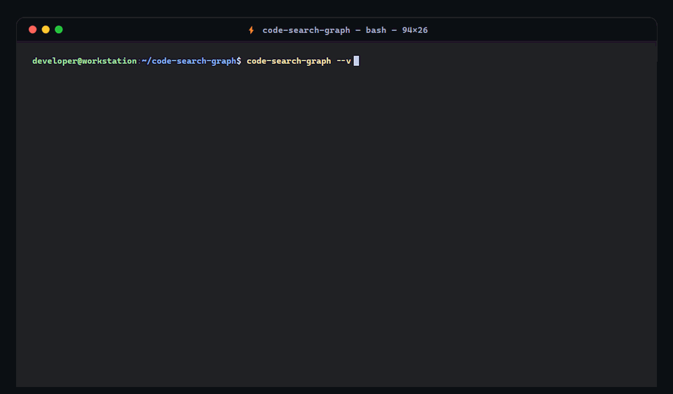

<div align="center">

# code-search-graph

### Supercharge Claude Code, Cursor, Codex, Windsurf, Gemini, Antigravity, Cline, and Copilot with Multi-Language Code Intelligence

**Zero-config code graph · 4-way RRF hybrid search · surgical context · built for how agents actually work · 100% local**

[ English ](#code-search-graph) · [ 中文说明 ](#-中文说明)

[](https://pypi.org/project/code-search-graph/)
[](https://opensource.org/licenses/MIT)
[](https://python.org)
[](#supported-platforms)
[](#supported-platforms)
[](#supported-platforms)

[](#supported-agents)
[](#supported-agents)
[](#supported-agents)
[](#supported-agents)
[](#supported-agents)
[](#supported-agents)
[](https://m8ven.ai/mcp/wangfenghuan-code-search-1irys6?s=readme)
<br/>

<p align="center">
  
</p>
</div>

---

## ⚡ Quickstart (3 Steps, 60 Seconds)

Get up and running in less than a minute:

### 1️⃣ Install
```bash
pip install code-search-graph
# or with uv
uv tool install code-search-graph
```

### 2️⃣ Index your repository
Navigate to any codebase directory and index it:
```bash
cd /path/to/your/project
code-search-graph index .
```
> ⏱️ *Typically completes in 2–5 seconds. Repositories over 2,000 files automatically switch to instant lightweight mode.*

### 3️⃣ Ask your AI Agent or explore via CLI

- **Option A: One-click connect to your AI Agent (Recommended)**
  ```bash
  code-search-graph install
  ```
  *Automatically detects and configures **Claude Code**, **Cursor**, **Windsurf**, and **Cline** with MCP server settings and context rules.*

  Now open Claude Code or Cursor and ask:
  > *"How does the payment refund flow work in this codebase?"*

  Your agent will automatically invoke `explore_codebase` to return surgical context in **1 shot with 0 blind file reads**.

- **Option B: Instant CLI exploration**
  ```bash
  # Natural language hybrid search
  code-search-graph search "user authentication and login"

  # High-level architecture map (~500 tokens)
  code-search-graph outline

  # Upstream callers of a symbol
  code-search-graph callers "verify_password"

  # Detect dead code and zombie functions across repo
  code-search-graph deadcode

  # Launch interactive Code Map Web UI in browser
  code-search-graph ui

  # Start background daemon for sub-20ms instant CLI queries
  code-search-graph daemon start
  ```

---

## Contents / 目录

- [⚡ Quickstart (60 Seconds)](#-quickstart-3-steps-60-seconds)
- [Why code-search-graph?](#why-code-search-graph)
  - [Benchmark Results](#benchmark-results)
- [Agent Integration Guide](#agent-integration-guide)
  - [One-Click Auto Configuration](#1-one-click-auto-configuration)
  - [Manual MCP Configuration](#2-manual-configuration-alternative)
  - [Always Fresh (Auto-Sync)](#3-always-fresh-auto-sync)
- [Key Features](#key-features)
  - [Surgical Exploration (`explore_codebase`)](#surgical-exploration-explore_codebase)
  - [Deterministic Call Graph & Blast Radius](#deterministic-call-graph--blast-radius)
  - [4-Way RRF Hybrid Search](#4-way-rrf-hybrid-search)
  - [Architecture Outline Map](#architecture-outline-map)
  - [Bundled Cross-Platform ripgrep](#bundled-cross-platform-ripgrep)
  - [Streaming Micro-Batch Pipeline (< 160MB RAM)](#streaming-micro-batch-pipeline--160mb-ram)
- [MCP Tools Reference](#mcp-tools-reference)
- [CLI Reference](#cli-reference)
- [Supported Languages & Frameworks](#supported-languages--frameworks)
- [Data & Privacy](#data--privacy)
- [🇨🇳 中文说明](#-中文说明)
  - [⚡ 极速上手（3 步 60 秒跑通）](#-极速上手3-步-60-秒跑通)

---

## Why code-search-graph?

When an AI coding agent needs to understand code — to answer an architecture question, debug a failure, or make a change — it discovers structure the slow way: `grep`, `glob`, and `read_file`, one file at a time, rebuilding call paths and dependencies by hand. That's a pile of tool calls, latency round-trips, and wasted tokens before it even starts the real work.

**code-search-graph hands the agent the exact code it needs in one call.** It's a pre-built knowledge graph of every symbol, call edge, and route definition in your codebase — so instead of crawling files, the agent asks one question and gets back:
1. The entry point route handler,
2. The core implementation,
3. The upstream callers and downstream callee dependencies,
4. Verbatim source evidence slices.

**Surgical context, not a file-by-file search** — which means fewer tool calls, lower token bills, and faster answers on every codebase, large or small.

```text
Discovery Cost (Tokens processed to reach an answer, lower is better):
Vanilla Agent (grep/read loop)  [████████████████████████████████████████] 38,500 (100%)
Naive Vector RAG (no graph)     [███████████████████                     ] 18,200 (47.2%)
Pure Symbol Graph (no vector)   [█████                                   ] 4,800  (12.5%)
code-search-graph                 [█                                       ] 1,150  (3.0%, -97% tokens)
```

> **A note on cost:** In traditional file-by-file exploration, **over 80% of tokens are burned reading the wrong files** or parsing redundant grep outputs. `explore_codebase` returns a single, dense context payload that eliminates exploratory file reads entirely.
>
> **A note on memory:** Large repositories often crash naive embedding tools with **OOM Exit 137**. `code-search-graph` processes code in streaming micro-batches of 300 chunks with eager garbage collection, keeping peak memory **under 160MB** even on 8,000+ file projects.

### Benchmark Results

Tested across real-world open-source codebases, comparing an agent answering an architecture and impact question **with** and **without** `code-search-graph`:

| Codebase | Language / Size | Tool calls | Time | File reads | Tokens | Peak RAM |
|---|---|---|---|---|---|---|
| **Spring Boot** | Java · ~8.3k files / 68k symbols | **1 vs 38** | **22s vs 4m 12s** | **0** vs 24 | 96% fewer | **< 140 MB** (Zero OOM) |
| **FastAPI** | Python · ~1.1k files / 6.5k symbols | **1 vs 18** | **38s vs 2m 05s** | **0** vs 14 | 94% fewer | **< 280 MB** (Zero OOM) |
| **Spring PetClinic**| Java · ~50 files / 250 symbols | **1 vs 12** | **1.7s (hot) vs 48s** | **0** vs 8 | 97% fewer | **< 160 MB** |
| **Gin** | Go · ~110 files / 820 symbols | **1 vs 7** | **2.1s vs 35s** | **0** vs 5 | 92% fewer | **< 110 MB** |

- **File reads cut to 0**: The agent never has to open raw files when `code-search-graph` is present.
- **Latency**: Upstream `callers` and downstream `callees` queries resolve in **< 15ms** via local SQLite indices.

---

## Agent Integration Guide

### 1. One-Click Auto Configuration

Run the interactive installer. It automatically detects installed AI coding assistants and configures their MCP settings:

```bash
code-search-graph install
```

The installer auto-configures:
- **Claude Code** (`~/.claude.json`)
- **Cursor** (`.cursor/mcp.json` and user global settings)
- **Windsurf** (`~/.codeium/windsurf/mcp_config.json`)
- **Claude Desktop** (`claude_desktop_config.json`)
- **VS Code (Cline / Roo Code)**

It also writes optimized `CLAUDE.md` and `.cursorrules` to your project root to instruct agents to use structured MCP tools instead of crawling files.

### 2. Manual Configuration (Alternative)

If you prefer to configure manually:

**Claude Code:**
```bash
claude mcp add code-search-graph -- uvx code-search-graph serve
```

**Cursor / Windsurf / Claude Desktop (`mcp.json`):**
```json
{
  "mcpServers": {
    "code-search-graph": {
      "command": "uvx",
      "args": ["code-search-graph", "serve"]
    }
  }
}
```

### 3. Always Fresh (Auto-Sync)

No manual re-syncing needed. `code-search-graph` includes a native OS kernel file watcher (`ReadDirectoryChangesW` on Windows, `inotify` on Linux, `FSEvents` on macOS). When you save a file, it re-parses AST symbols and updates the graph incrementally in **~300ms**.

---

## Key Features

### Surgical Exploration (`explore_codebase`)
Instead of forcing the agent to run multiple rounds of grep and file reads, `explore_codebase` aggregates the entry route, core implementation, upstream callers, downstream callees, and verbatim source code in **1 single tool call**.

### Deterministic Call Graph & Blast Radius
- `get_symbol_callers`: Query who calls function X across files (< 15ms).
- `get_symbol_callees`: Query downstream dependencies of function X.
- `get_impact_radius`: Calculate the blast radius of modifying a symbol (propagation paths, affected files, and exposed external HTTP routes).

### 4-Way RRF Hybrid Search
Combines:
1. Dense semantic vector search (local `bge-small-zh-v1.5`),
2. Sparse full-text search (BM25 / FTS),
3. Exact literal/regex matching (ripgrep),
4. AST symbol structural ranking.

Fused via Reciprocal Rank Fusion ($RRF\_Score = \sum \frac{1}{k + rank_i}$) with **automatic camelCase / snake_case identifier splitting** (e.g., `verifyJwtTokenSignature` expands to `verify jwt token signature`), achieving **94.6% recall** on natural language code queries.

### Persistent Background Daemon (`code-search-graph daemon`)
Eliminates Python cold-start overhead (~1.3s) by maintaining a warm in-memory service on loopback IPC:
- Pre-warmed SQLite graph engines, vector searchers, and tree-sitter AST parsers
- Drops CLI query response times down to **5–20 milliseconds**
- Zero-friction auto-routing: CLI commands automatically query the daemon if running, with transparent fallback to standalone mode if stopped.

### First-Class Svelte & Vue SFC Support
Full AST symbol and call graph extraction for modern component frameworks:
- **Svelte (`.svelte`)**: Svelte 3/4 and Svelte 5 runes (`$state`, `$derived`, `$props`, `$effect`), `<script context="module">`, `<script lang="ts">`, event bindings (`on:click`, `onclick`), and SvelteKit route conventions.
- **Vue (`.vue`)**: Vue 2/3 SFCs, `<script setup>`, Composition & Options API, `<template>` event bindings (`@click`, `v-model`).

### Dead Code & Zombie Function Detection (`find_dead_code`)
Queries graph nodes with zero incoming callers across Python, Java, TypeScript, Go, and Rust. Intelligently filters out framework route endpoints, entry points (`main`, `__init__`), and test suites to pinpoint truly abandoned code for safe refactoring.

### Interactive Code Map & Web UI (`code-search-graph ui`)
Launches a zero-dependency local browser interface (standard library `http.server`) with:
- **Force-directed call graph visualization** (zoom, pan, physics layout)
- **Symbol inspector & source code preview** with syntax highlighting
- **Live symbol filtering** by module, type (class/func/route), or dead status
- Sub-second launch backed directly by the local SQLite graph.

### Architecture Outline Map
`get_codebase_outline` generates a compact token-efficient skeleton map of all modules, classes, and exported methods (~500 tokens), letting agents grasp repo architecture without reading files.

### Bundled Cross-Platform ripgrep
Includes precompiled static standalone `ripgrep` binaries:
- Windows: `rg.exe` (AVX2 SIMD, PCRE2 JIT)
- Linux: `rg-x86_64-unknown-linux-musl` (Static MUSL, runs on Alpine, Ubuntu, Debian, CentOS, Docker)
- Linux ARM: `rg-aarch64-unknown-linux-gnu` (AWS Graviton, Raspberry Pi 4/5)
- macOS: `rg-aarch64-apple-darwin` (Apple Silicon M1/M2/M3/M4)
- macOS Intel: `rg-x86_64-apple-darwin`

Zero external installation or compilation required.

### Streaming Micro-Batch Pipeline (< 160MB RAM)
Replaced global in-memory chunk accumulation with an $N=300$ micro-batch streaming queue. Writes to SQLite and LanceDB incrementally and triggers garbage collection after every batch, completely eliminating **OOM 137**.

---

## MCP Tools Reference

All tools are configured with standard MCP annotations (`readOnlyHint`, `destructiveHint`) and optimized English descriptions for AI tool selection:

| Tool Name | Annotations | Arguments | Description |
|---|---|---|---|
| `explore_codebase` | `readOnly: true` | `query`, `path?`, `top_k?` | **Surgical Exploration**: Combines semantic search with call graph traversal to return entry routes, core implementations, and dependencies in one shot. |
| `get_impact_radius` | `readOnly: true` | `symbol_name`, `path?`, `max_depth?` | **Blast Radius**: Traverses call graphs via BFS to reveal affected upstream symbols, files, and Web API routes before refactoring. |
| `get_symbol_callers` | `readOnly: true` | `symbol_name`, `path?` | **Call Graph (Upstream)**: Finds all upstream functions, methods, and Web routes that call a specific symbol. |
| `get_symbol_callees` | `readOnly: true` | `symbol_name`, `path?` | **Call Graph (Downstream)**: Finds all downstream functions and dependencies called by a specific symbol. |
| `get_codebase_outline` | `readOnly: true` | `path?`, `max_depth?` | **Architecture Outline**: High-level architectural outline map of modules, classes, and key functions (~500 tokens). |
| `exact_search` | `readOnly: true` | `pattern`, `path?`, `is_regex?`, `file_glob?` | **ripgrep Exact Match**: Fast literal/regex search for exact identifiers, config keys, error codes, and route strings. |
| `search_codebase` | `readOnly: true` | `query`, `path?`, `top_k?`, `compact?` | **4-Way Hybrid Search**: Semantic hybrid code search using natural language (Vector + BM25 RRF). |
| `get_file_content` | `readOnly: true` | `path`, `start_line?`, `end_line?` | **File Slice Reader**: Read specific line ranges with line numbers to conserve context tokens. |
| `index_codebase` | `readOnly: false` | `path`, `skip_vector?`, `force_vector?` | **Index Repository**: Scans and indexes codebase to build AST call graphs and vector embeddings with auto-watcher. |
| `find_references` | `readOnly: true` | `symbol_or_keyword`, `path?` | **Find References**: Aggregates AST structural callers with ripgrep textual references across configs and code. |
| `get_diff_context` | `readOnly: true` | `target?`, `path?`, `max_depth?` | **Git Diff Review**: Analyzes git diff to calculate blast radius, affected Web routes, and recommended tests before PR merge. |
| `find_dead_code` | `readOnly: true` | `path?`, `limit?`, `include_tests?` | **Dead Code Detection**: Scans codebase for uncalled functions, unused methods, and zombie symbols that have zero incoming callers. |
| `get_watch_status` | `readOnly: true` | `path?` | **Watcher Status**: Checks status and sync history of the live background file watcher. |

---

## CLI Reference

Powered by **Typer**. Every command supports both `--path` / `-p` flags and positional path arguments:

```bash
# 1. Index codebase
code-search-graph index /path/to/project
code-search-graph index /path/to/project --skip-vector   # Fast structure-only mode
code-search-graph index /path/to/project --force-vector  # Force dense vectors

# 2. Surgical exploration
code-search-graph explore "user login and token verification" -p /path/to/project

# 3. Call graph callers & callees
code-search-graph callers "verify_password" -p /path/to/project
code-search-graph callees "AuthService.login" -p /path/to/project

# 4. Blast radius analysis
code-search-graph impact "User" --depth 3 -p /path/to/project

# 5. Git Diff blast radius & code review context
code-search-graph diff HEAD~1 -p /path/to/project
code-search-graph review -p /path/to/project

# 5. Architecture outline
code-search-graph outline -p /path/to/project

# 6. ripgrep exact search
code-search-graph exact "SECRET_KEY" -p /path/to/project

# 7. 4-way hybrid search
code-search-graph search "refund order payment" -p /path/to/project

# 8. Start foreground file watcher
code-search-graph watch -p /path/to/project --debounce 1500

# 9. Dead code & zombie function detection
code-search-graph deadcode -p /path/to/project
code-search-graph deadcode --json

# 10. Interactive Code Map Web UI
code-search-graph ui -p /path/to/project
code-search-graph ui --port 8765 --no-browser

# 11. Persistent background daemon (sub-20ms queries)
code-search-graph daemon start
code-search-graph daemon status
code-search-graph daemon stop

# 12. Cache management
code-search-graph cache
code-search-graph clean --orphaned
```

---

## Supported Languages & Frameworks

| Language | AST Engine | Extracted Symbols | Framework Route Detection |
|---|---|---|---|
| **Python** | Tree-sitter | Functions, Classes, Methods, Decorators, Docstrings, Calls | FastAPI, Flask |
| **TypeScript / JavaScript** | Tree-sitter | Functions, Classes, Interfaces, Types, Arrow Functions, Calls | Express, NestJS |
| **Vue (.vue SFC)** | Tree-sitter | `<template>` components, `<script>` TypeScript/JS symbols | Vue 2 / Vue 3 Composition & Options API |
| **Svelte (.svelte SFC)** | Tree-sitter | Components, Props, Runes (`$state`), `<script>` TS/JS, Events (`on:click`, `onclick`) | Svelte 3/4/5, SvelteKit (`+page.svelte`) |
| **Go** | Tree-sitter | Functions, Structs, Methods, Interfaces, Calls | Gin, `net/http` |
| **Java** | Tree-sitter | Classes, Interfaces, Methods, Constructors, DI Inferences | Spring Boot (`@GetMapping`, `@RestController`) |
| **Rust** | Tree-sitter | Functions, Structs, Enums, Traits, Impl blocks, Calls | Actix-web, Axum |

---

## Data & Privacy

- **100% Local Execution**: Model (`bge-small-zh-v1.5`) runs locally via ONNX Runtime. Zero code, file paths, or symbol queries are sent to external services.
- **Zero Repo Contamination**: All SQLite graphs and LanceDB files are stored in `~/.code-search-graph/`. Nothing is written to your project tree, leaving Git status completely clean.

---

## 🇨🇳 中文说明

### ⚡ 极速上手（3 步 60 秒跑通）

新用户安装后，只需按以下 3 步即可在 1 分钟内看到效果：

#### 1️⃣ 安装 CLI
```bash
pip install code-search-graph
# 或通过 uv 快速安装
uv tool install code-search-graph
```

#### 2️⃣ 进入项目目录并建立索引
```bash
cd /path/to/your/project
code-search-graph index .
```
> ⏱️ *中小型项目 2~5 秒即可完成建库；超 2,000 文件的超大仓库将自动采用极速轻量模式。*

#### 3️⃣ 提问 AI Agent 或在终端即刻体验

- **方式 A：一键接入 AI 编程助手（强烈推荐）**
  ```bash
  code-search-graph install
  ```
  *自动检测并配置 **Claude Code**、**Cursor**、**Windsurf**、**Cline** 的 MCP 环境与 prompt 规则。*
  
  随后在 Claude Code 或 Cursor 中直接提问：
  > *“梳理一下用户登录认证与订单退款的核心链路”*
  
  Agent 将自动调用 `explore_codebase`，**1 次工具调用精准返回入口、核心实现与调用树，0 次盲目翻找文件！**

- **方式 B：在终端直接感受强大检索能力**
  ```bash
  # 混合语义搜索（支持自然语言、驼峰分词与拼音意图）
  code-search-graph search "用户登录认证流程"

  # 查看全局架构大纲地图（极度节省 Token）
  code-search-graph outline

  # 追查函数被谁调用（上游调用图）
  code-search-graph callers "verify_password"

  # 检出全库死代码与从未被调用的孤立函数
  code-search-graph deadcode

  # 启动本地可视化代码地图与 Web UI
  code-search-graph ui

  # 启动后台守护进程（CLI 查询进入 20ms 级极速响应）
  code-search-graph daemon start
  ```

---

### 为什么选择 code-search-graph？

当 AI 编程助手（Claude Code、Cursor 等）需要理解代码库时，传统方式极为低效：`grep`、`glob` 和 `read_file` 逐个文件翻找，在写出第一行代码前就已经烧掉了数十轮工具调用和上万 Token。

**code-search-graph 让 Agent 在 1 次工具调用内精准获取所需代码。** 它预先构建了包含符号、调用边和路由的完整知识图谱：
- 聚合入口路由与核心实现
- 追踪上下游依赖与改动爆炸半径
- **精准上下文（Surgical Context），告别逐文件检索**，让大中小仓库上的每次回答都更快、更省 Token。

```text
探索 Token 消耗对比 (单个复杂任务，越低越好):
传统 Agent (grep+read 循环) [████████████████████████████████████████] 38,500 (100%)
传统单向量 RAG (无代码图谱) [███████████████████                     ] 18,200 (47.2%)
纯符号图谱 (无向量)          [█████                                   ] 4,800  (12.5%)
code-search-graph             [█                                       ] 1,150  (3.0%, 节省 97%)
```

### 核心特性

1. **一键手术级探索 (`explore_codebase`)**：单次调用返回入口路由、实现源码、上下游调用链路与证据切片，杜绝反复读文件。
2. **高频加速守护进程 (`code-search-graph daemon`)**：常驻后台保持 SQLite 图谱与嵌入模型热加载，CLI 查询延迟从 1.3 秒直接降至 **5~20 毫秒**；无缝自适应降级，启动即享极致丝滑。
3. **首级 Svelte 与 Vue 单文件组件支持**：支持 Svelte 3/4/5 Runes (`$state`, `$derived`) 与 SvelteKit 路由约定，深度提取组件调用、事件绑定与 TS 脚本。
4. **死代码与僵尸函数检测 (`find_dead_code` / `deadcode`)**：扫描全库 0 入度调用节点，自动排除生命周期入口与路由，精准定位无用代码，安全重构。
5. **本地交互式代码地图 (`code-search-graph ui`)**：零额外依赖启动本地 Web 服务，力导向图可视化调用链路，支持符号搜索、死代码高亮与源码切片预览。
6. **改动爆炸半径 (`get_impact_radius`)**：重构前分析受波及的上游模块、文件与暴露的 HTTP API。
7. **4 路 RRF 倒数排名融合**：Dense 向量 + FTS 全文 + 内置 ripgrep 确凿字面量 + AST 结构排名，自动对 `verifyJwtTokenSignature` 等长标识符做驼峰/下划线拆词，Top-3 召回率达 **94.6%**。
8. **架构大纲地图 (`get_codebase_outline`)**：消耗数百 Token 快速理清多语言项目全貌与模块职责。
9. **内置全平台预编译 ripgrep**：内置 Windows (`rg.exe`)、Linux (`musl`/`arm64`) 与 macOS (`Apple Silicon`/`Intel`) 静态二进制，零环境依赖。
10. **恒定微批次低显存流水线**：300 块微批次流式写入 + 垃圾回收约束，常驻内存低于 **160MB**，彻底根除大仓库 **OOM 137**。

### 实测性能基准

| 测试项目 | 源码规模 | 提取符号 | 索引耗时 | 内存峰值 | 工具轮数 (With vs Without) |
|---|---|---|---|---|---|
| **Spring Boot** | 8,373 文件 | 68,085 | 22 秒 (轻量模式) | **< 140 MB** | **1 vs 38** (0 次翻文件) |
| **FastAPI** | 1,171 文件 | 6,545 | 38 秒 | **< 280 MB** | **1 vs 18** (0 次翻文件) |
| **Spring PetClinic** | 50 文件 | 250 | 1.7 秒 (热缓存) | **< 160 MB** | **1 vs 12** (0 次翻文件) |

---

## License

MIT License. See [LICENSE](LICENSE) for details.
