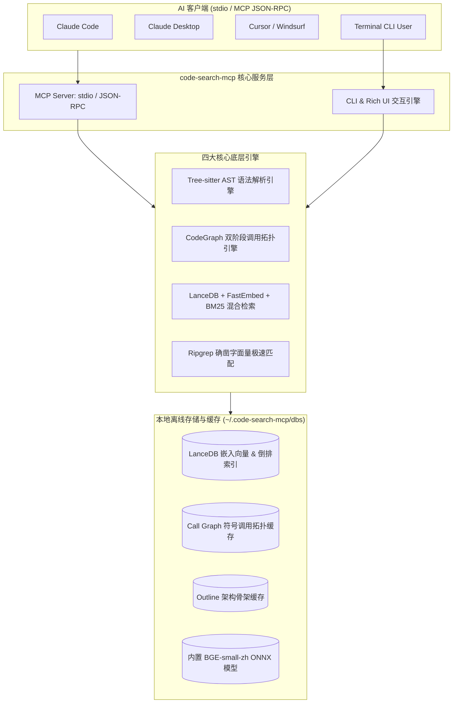

# 🏛️ code-search-mcp 架构设计与工程规范文档

本文档详细描述 `code-search-mcp` 的系统架构、核心模块设计、工程目录组织以及关键算法实现。

---

## 1. 系统总体架构

`code-search-mcp` 是专为 AI 辅助编程客户端（Claude Desktop / Claude Code / Cursor / Windsurf / Cline）设计的高性能、轻量级、本地化代码检索与图谱拓扑服务。



---

## 2. 工程目录组织规范

项目遵循现代化 Python `src-layout` 规范，严格保证代码分层与模块边界清晰：

```text
code-search-mcp/
├── .cursor/                         # Cursor IDE 配置目录 (mcp.json)
├── docs/                            # 官方文档中心
│   ├── architecture.md              # 系统架构、模块设计与拓扑规范
│   └── docker_guide.md              # Docker 部署与容器化实战指南
├── scripts/                         # 实用运维与部署脚本
│   ├── docker-run.ps1               # Windows PowerShell Docker 启动器
│   └── docker-run.sh                # Linux / macOS Shell Docker 启动器
├── src/code_search_mcp/             # 核心服务源码包
│   ├── bin/                         # 跨平台预编译二进制工具 (Ripgrep)
│   ├── models/                      # 内置离线量化模型 (BGE-small-zh ONNX)
│   ├── __init__.py                  # 包入口与版本导出
│   ├── server.py                    # MCP stdio JSON-RPC 服务协议实现 (10 个工具)
│   ├── cli.py                       # CLI 命令行入口解析器 (11 个子命令)
│   ├── ui.py                        # Rich 终端 UI、语法高亮与卡片渲染引擎
│   ├── config.py                    # 配置中心 (向量维度、环境变量自适应解析)
│   ├── multilang_parser.py          # Tree-sitter 多语言 (Python/TS/JS/Go) AST 解析
│   ├── graph_engine.py              # CodeGraph 调用拓扑、双阶段消歧与 BFS 爆炸半径
│   ├── indexer.py                   # LanceDB 向量 + 全文混合索引器
│   ├── searcher.py                  # RRF 多路召回融合检索器 (Dense + BM25)
│   ├── outline.py                   # 全局架构骨架提取器 (极省 Token)
│   ├── ripgrep_engine.py            # Ripgrep 精准字面量与正则搜索引擎
│   ├── embeddings.py                # FastEmbed 向量嵌入引擎 (内置离线优先)
│   ├── cache_manager.py             # 全局索引缓存监控与孤儿垃圾回收
│   ├── installer.py                 # 一键向导式全自动客户端配置器
│   └── watcher.py                   # 实时文件系统热监控增量更新引擎
├── tests/                           # 自动化测试与工业级基准测试套件
│   ├── benchmark_repos/             # 真实工业级开源大仓测试集 (Django, VS Code)
│   ├── reports/                     # 基准测试生成的度量指标报告产物
│   ├── sample_project/              # 多语言单元测试微型工程 (Python/TS/Go)
│   ├── test_cli.py                  # CLI 12 个子命令端到端自动化测试
│   ├── test_search.py               # 检索与索引核心功能单元测试
│   ├── test_two_phase_resolution.py # 复杂重名跨文件调用精准消歧测试
│   ├── test_benchmark.py            # 基础综合性能基准测试
│   ├── test_django_benchmark.py     # Django (3,000 文件) 工业级实测基准
│   └── test_vscode_benchmark.py     # VS Code (11,000 文件) 超大仓实测基准
├── .cursorrules                     # Cursor 提示词与规范声明
├── .dockerignore                    # Docker 构建镜像过滤规则
├── .gitattributes                   # Git 属性配置
├── .gitignore                       # Git 忽略配置
├── .python-version                  # 推荐 Python 版本 (3.10+)
├── CLAUDE.md                        # Claude Code / Claude Desktop 开发规范
├── docker-compose.yml               # Docker Compose 编排文件
├── Dockerfile                       # 生产级极简轻量 Docker 镜像
├── install.py                       # 极简一键安装运行向导 (python install.py)
├── LICENSE                          # 开源许可证 (Apache 2.0)
├── main.py                          # 顶层极速入口 (python main.py / uv run main.py)
├── pyproject.toml                   # 项目依赖与元数据配置 (PEP 517/621)
├── README.md                        # 项目主文档 (中英双语、特性介绍)
└── uv.lock                          # 依赖确切版本锁定文件
```

---

## 3. 核心子系统与关键算法

### 3.1 CodeGraph 双阶段符号调用消歧算法 (Two-Phase Resolution)
在大型多模块仓库（如 Django、VS Code）中，同一个函数名或类名可能存在数十个同名定义。传统词法匹配会导致极高的误报。
- **阶段 1：模块定义抽取 (Extraction Pass)**
  遍历 AST 提取所有函数的定义坐标、文档字符串及内部调用点（Caller -> Callee），构建全局定义符号表。
- **阶段 2：作用域精准解析与消歧 (Resolution Pass)**
  1. **同文件内优先**：若被调用符号在当前文件定义，优先绑定；
  2. **显式 Import 解析**：解析 Python `from x import y` / TS `import { y } from 'x'`，通过模块路径绝对解析；
  3. **后缀倒排索引加速 (Suffix-Tail Inverted Index)**：在跨文件模糊推断中，将 `O(N)` 降至 `O(1)`，使万级文件的全图解析耗时从几分钟压至 0.6 秒。

### 3.2 混合检索 RRF (Reciprocal Rank Fusion)
结合密集向量与稀疏检索的优点，通过倒数排名融合算法综合评分：
$$RRF\_Score(d) = \sum_{m \in \{Dense, BM25\}} \frac{1}{k + rank_m(d)}$$
其中 $k=60$ 为平滑常数。保证高意图相关性的代码块排在最前，同时兼顾关键字精准匹配。

### 3.3 离线内置模型架构
默认随附经 ONNX 优化的 `BAAI/bge-small-zh-v1.5` 权重文件（仅 90MB），启动时直接通过本地内存映射加载，实现 0 网络请求、0 外部 API Key、纯 CPU 毫秒级推理。
