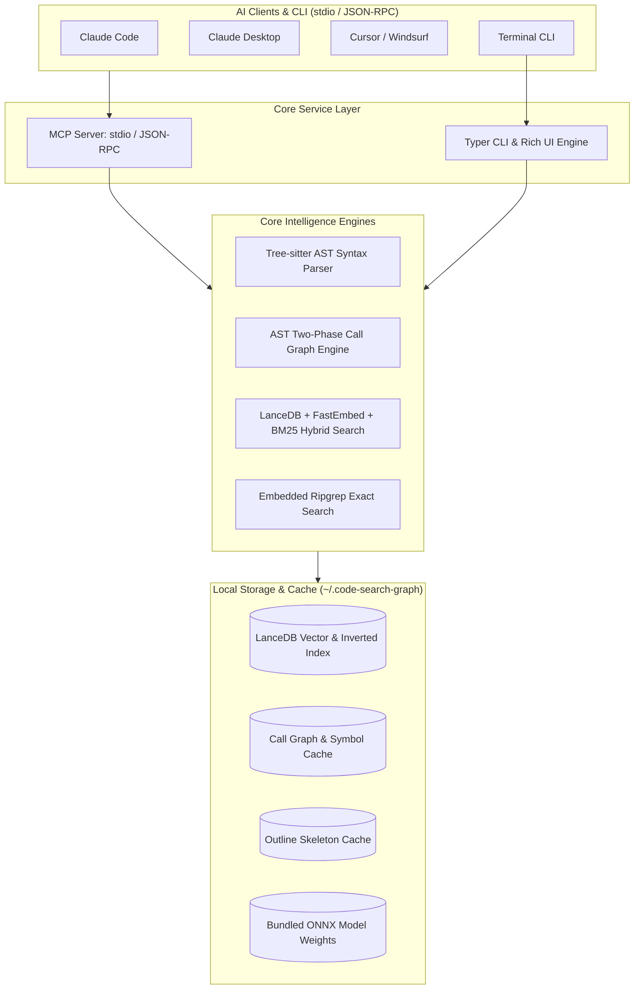

# 🏛️ code-search-graph Architecture & Design Specification

This document details the system architecture, core engine design, directory layout, and key algorithms behind `code-search-graph`.

---

## 1. System Architecture

`code-search-graph` is a fast, lightweight, local code intelligence and graph topology service designed for AI coding assistants (Claude Desktop, Claude Code, Cursor, Windsurf, Cline, Antigravity) and terminal developers.



---

## 2. Repository Layout

The project follows the modern Python `src-layout` with explicit modular boundaries:

```text
code-search-mcp/
├── .cursor/                         # Cursor IDE configuration
├── docs/                            # Documentation center
│   ├── architecture.md              # System architecture and specifications
│   └── docker_guide.md              # Docker deployment guide
├── scripts/                         # Operational launcher scripts
│   ├── docker-run.ps1               # Windows PowerShell Docker launcher
│   └── docker-run.sh                # Linux / macOS Shell Docker launcher
├── src/code_search_mcp/             # Core Python package
│   ├── bin/                         # Bundled cross-platform ripgrep binaries
│   ├── models/                      # Bundled offline ONNX model weights
│   ├── parsers/                     # Modular Tree-sitter AST parsers
│   │   ├── common.py                # Base data structures & utilities
│   │   ├── dispatcher.py            # Language routing facade
│   │   ├── python.py                # Python AST parser & call extractor
│   │   ├── javascript.py            # TypeScript / JavaScript parser
│   │   ├── vue.py                   # Vue SFC parser
│   │   ├── java.py                  # Java Spring Boot & class parser
│   │   ├── go.py                    # Go struct & method parser
│   │   └── rust.py                  # Rust trait & struct parser
│   ├── __init__.py                  # Public exports
│   ├── server.py                    # FastMCP stdio server (11 tools)
│   ├── cli.py                       # CLI application & command dispatchers
│   ├── ui.py                        # Rich terminal UI, cards & progress bars
│   ├── config.py                    # Global constants & cache path resolver
│   ├── graph_engine.py              # Call graph resolution, BFS trace & impact radius
│   ├── indexer.py                   # Micro-batch streaming indexer (SQLite + LanceDB)
│   ├── searcher.py                  # 4-way RRF hybrid searcher
│   ├── outline.py                   # High-level architecture outline extractor
│   ├── ripgrep_engine.py            # Embedded ripgrep search engine
│   ├── embeddings.py                # FastEmbed / ONNX Runtime vector embeddings
│   ├── installer.py                 # One-click client auto-configurator
│   └── watcher.py                   # Real-time background file watcher
└── tests/                           # Test suite and benchmarks
    ├── test_cli.py                  # CLI end-to-end test suite
    ├── test_search.py               # Search & indexing tests
    ├── test_two_phase_resolution.py # Two-phase call graph disambiguation tests
    └── sample_project/              # Multi-language sample repository
```

---

## 3. Core Subsystems & Key Algorithms

### 3.1 Two-Phase AST Call Graph Resolution
In large repositories (e.g., Django, VS Code), the same function or method name can have dozens of definitions across different files. Pure lexical matching causes severe false positives. `code-search-graph` implements a deterministic two-phase resolution algorithm:

1. **Extraction Pass (AST Analysis)**:
   Extracts all class/function definitions, leading comments/docstrings, and call invocations (`caller -> callee`) per file into an inverted definition table.
2. **Resolution Pass (Disambiguation)**:
   - **File-local Priority**: If the called symbol is defined within the same file, resolve locally.
   - **Explicit Import Resolution**: Resolves Python `from x import y` and TypeScript `import { y } from 'x'` to canonical module paths.
   - **Suffix-Tail Inverted Index**: For cross-file ambiguous calls, indexing symbols by `(symbol_name, file_stem)` collapses resolution time from $O(N)$ to $O(1)$, resolving tens of thousands of files in under 0.6s.

### 3.2 4-Way Reciprocal Rank Fusion (RRF)
Combines dense vector embeddings, BM25 full-text keyword scoring, and exact symbol matching using Reciprocal Rank Fusion:

$$RRF(d) = \sum_{m \in M} \frac{w_m}{k + rank_m(d)}$$

Where $k = 60$ is the smoothing constant and $w_m$ is the engine weight. This guarantees that conceptually relevant chunks rank high while exact symbol and identifier matches are preserved.

### 3.3 Zero-Network Offline Operation
By default, the engine bundles precompiled static ripgrep binaries and supports bundled quantized ONNX model weights (`BAAI/bge-small-zh-v1.5`, ~90MB). All embeddings run locally via ONNX Runtime on CPU with zero network egress, zero API keys, and sub-millisecond execution.
